# pstream — single-tenant payment state streaming (CDC POC)

Proof of concept for the pattern **"full payment state in Kafka, key = `payment_id`,
downstream consumer upserts into its own database"**, where the source table holds
many tenants but the Kafka topic carries exactly one.

```
partitioned Postgres ──▶ Debezium (pgoutput) ──▶ Kafka (Avro, compacted) ──▶ Go sink ──▶ Postgres
   3 tenants              publication filters        payments.state            upsert guarded
   monthly partitions     to one tenant              key = payment_id          by updated_at
```

## Architecture

Solid arrows are the payment data path; dotted arrows are control, schema and
observability relationships. Every box is a Docker Compose service (or an object
inside one).

```mermaid
flowchart LR
    subgraph gen_svc["generator (Go)"]
        GEN["payment lifecycles<br/>created → processing → final<br/>tenants: tenant_a / b / c"]
    end

    subgraph pg_src["postgres-source  :5432"]
        PAY[("payments<br/>PARTITION BY RANGE (created_at)<br/>PK (payment_id, created_at)<br/>REPLICA IDENTITY FULL")]
        PUB["publication dbz_payments<br/>WHERE tenant_id = TARGET_TENANT<br/>publish_via_partition_root"]
        SLOT["replication slot dbz_payments<br/>plugin: pgoutput"]
        PAY -- "WAL (wal_level=logical)" --> PUB --> SLOT
    end

    GEN -- "INSERT / UPDATE<br/>all tenants" --> PAY

    subgraph connect_svc["connect  :8083 (Debezium + Avro converter)"]
        DBZ["PostgresConnector 'payments'<br/>snapshot: initial, filtered SELECT override<br/>message.key.columns = payment_id"]
        SMT["SMT chain:<br/>unwrap (ExtractNewRecordState)<br/>route (RegexRouter → payments.state)"]
        DBZ --> SMT
    end

    SLOT -- "stream changes<br/>(one tenant only)" --> DBZ
    PAY -. "initial snapshot<br/>SELECT … WHERE tenant_id = TARGET_TENANT" .-> DBZ

    subgraph kafka_svc["kafka  :9092 (KRaft, single node)"]
        TOPIC["payments.state<br/>6 partitions, cleanup.policy=compact<br/>key = payment_id (Avro)<br/>value = full row, 15 fields (Avro)"]
        HB["__debezium-heartbeat.cdc"]
        INT["connect-configs / -offsets / -status"]
    end

    SMT -- "produce (Avro)" --> TOPIC
    DBZ -.-> HB
    connect_svc -. "worker state" .-> INT

    SR["schema-registry  :8081<br/>payments.state-key / -value"]
    SMT -. "register schemas" .-> SR

    subgraph sink_svc["sink (Go)"]
        CONS["consumer group 'sink'<br/>commit offset only after upsert"]
        UPS["UPSERT … ON CONFLICT (payment_id)<br/>WHERE updated_at < EXCLUDED.updated_at"]
        CONS --> UPS
    end

    TOPIC -- "consume (Avro)" --> CONS
    CONS -. "fetch schemas" .-> SR

    subgraph pg_sink["postgres-sink  :5433"]
        SPAY[("payments<br/>plain table, PK payment_id<br/>single tenant only")]
    end

    UPS --> SPAY

    INIT["init-topics (one-shot)"] -. "create topics" .-> kafka_svc
    REG["register-connector (one-shot)<br/>PUT /connectors/payments/config"] -. "register" .-> DBZ
    DUMP["topicdump (make verify)"] -. "read whole topic" .-> TOPIC

    AKHQ["AKHQ  :8080"] -.-> kafka_svc
    AKHQ -.-> SR
    AKHQ -.-> connect_svc

    PGADMIN["pgAdmin  :5050<br/>both servers pre-connected"] -.-> pg_src
    PGADMIN -.-> pg_sink

    subgraph monitoring["monitoring"]
        OTEL["otel-collector<br/>scrape → OTLP push"]
        PROM["prometheus  :9090<br/>OTLP receiver"]
        GRAF["grafana  :3000<br/>Debezium dashboard"]
        PGEXP["postgres-exporter<br/>replication slot lag"]
        OTEL -- "OTLP/HTTP" --> PROM
        GRAF -.-> PROM
    end

    OTEL -. "scrape :9404 (JMX exporter)" .-> connect_svc
    OTEL -. "scrape :9187" .-> PGEXP
    PGEXP -. "pg_replication_slots" .-> pg_src
```



Dependency order at startup (`depends_on` + healthchecks): the databases and
Kafka come up first; `init-topics` creates the topics; Connect starts once
Kafka, Schema Registry and the source database are healthy; `register-connector`
then registers the connector; the generator and sink start only after the
connector is in place, so no change is ever produced before CDC is listening.

## The pattern

This is event-carried state transfer: every change ships the **full row after the
change** (no Debezium `before/after` envelope — `ExtractNewRecordState` unwraps it),
so any consumer can rebuild its own queryable copy with a plain upsert and no joins.
The topic is **compacted** with key `payment_id`, so it converges towards exactly one
record per payment — a snapshot of current state that any new consumer can bootstrap
from, while recent history (several records per payment with different `status`)
remains visible until compaction runs.

The Postgres primary key is composite — `(payment_id, created_at)` — because
Postgres requires the partition key inside the PK of a partitioned table. The Kafka
key is still **`payment_id` only** (`message.key.columns`): downstream identity is
the payment, and one payment must always land in the same topic partition for
ordering, regardless of which table partition it lives in.

The tenant filter lives **in the publication** (`CREATE PUBLICATION … WHERE
tenant_id = …`), not in an SMT: rows of other tenants never leave the database
process at all. Two things are required for that to be correct:

- **`REPLICA IDENTITY FULL`** on the parent *and every partition* — the row filter
  references `tenant_id`, which is not part of the PK, so Postgres refuses to
  publish UPDATE/DELETE without it. Replica identity is a per-partition property;
  it is set in the same place partitions are created (`postgres/init/01_schema.sql.tmpl`).
- **The snapshot override** (`snapshot.select.statement.overrides`) — Debezium's
  initial snapshot reads the table directly and *bypasses the publication*, so
  without an explicit `WHERE tenant_id = …` the other tenants would leak into the
  topic on the first load.

The sink upsert is guarded by `WHERE payments.updated_at < EXCLUDED.updated_at`,
which makes it idempotent: replays (e.g. after a re-snapshot) and reordered
deliveries can never overwrite newer state with older state.

### Excluding sensitive columns

The source table carries one column downstream consumers must never see:
`card_token` (a tokenized card reference — synthetic in this POC). The connector
is configured with an **allowlist** of the columns that *are* published:

```json
"column.include.list": "public.payments.tenant_id,public.payments.payment_id,…"
```

An allowlist fails **closed**: when someone later adds another sensitive column
to the table, it stays out of Kafka by default instead of leaking until a
`column.exclude.list` catches up. The price is restating every published column
(Debezium forbids combining the two lists), which is acceptable for one table.

Debezium removes filtered columns **before serialization**, so `card_token` is
absent from the registered Avro schema itself, not blanked per record — nothing
about it ever reaches Kafka, in either the initial snapshot or streaming. The
sink table simply has no such column (`postgres/sink-init/01_schema.sql`), and
`make verify` check 7 proves the chain: values present in the source, zero
occurrences in the topic, no column in the sink.

Note where this filter *cannot* live: a publication **column list** (`CREATE
PUBLICATION … FOR TABLE payments (col, …)`) would stop the value even earlier
(it would never leave the database process, like the tenant row filter), but
Postgres rejects column lists for UPDATE/DELETE publications unless the list
covers the replica identity — and this table needs `REPLICA IDENTITY FULL` for
the row filter, i.e. *all* columns. So the row filter lives in the publication,
the column filter in the connector. With `column.include.list` the excluded value
does cross the replication slot to Debezium, which is acceptable: the connector
is part of the trusted side; the topic is the security boundary here.

## Active variant

The **publication row filter works** on this PostgreSQL 18 / Debezium 3.7
combination (with `publish_via_partition_root = true` streaming arrives from the
parent `public.payments`, and the snapshot of the parent covers all partitions with
`table.include.list = public.payments` — no per-partition listing needed). The
fallback described in the plan (unfiltered publication + Debezium scripting
`Filter` SMT) was therefore **not** needed and is not wired in.

## Quick start

Requires Docker with Compose v2. For `make verify` also `curl` and `python3`.

```bash
make up       # renders templates, builds, starts everything, waits for health
make verify   # 7 PASS/FAIL checks (connector, partitioning, counts, tenant isolation, column exclusion)
make logs     # follow all logs
make down     # stop (keep volumes)
make clean    # stop and delete volumes
```

`make up` finishes with all services healthy and the connector registered —
no manual steps. Configuration lives in `.env` (image versions, `TARGET_TENANT`,
generator settings). All credentials there are throwaway test values.

| UI / API         | URL                    |
|------------------|------------------------|
| AKHQ             | http://localhost:8080  |
| pgAdmin          | http://localhost:5050  |
| Grafana          | http://localhost:3000/d/pstream-debezium |
| Prometheus       | http://localhost:9090  |
| Kafka Connect    | http://localhost:8083  |
| Schema Registry  | http://localhost:8081  |
| Connect metrics  | http://localhost:9404/metrics |

pgAdmin opens without a login (desktop mode, POC only) with both databases
pre-connected: **source (payments)** — the partitioned multi-tenant table — and
**sink** — the single-tenant copy the consumer maintains.

## What to look at in AKHQ

- **Topics → `payments.state`**: live data, decoded Avro. The key is
  `{"payment_id": …}` only; the value is the full 15-field row. Search for one
  `payment_id` to see its lifecycle (`created → processing → success/failed/refunded`).
- **Topics → `payments.state` → Configs**: `cleanup.policy=compact`,
  `min.compaction.lag.ms=60000`, `retention.ms=-1`.
- **Schema Registry**: subjects `payments.state-key` / `payments.state-value`.
- **Connect**: connector `payments`, state RUNNING.

## Monitoring

Debezium publishes its metrics as JMX MBeans; the monitoring pipeline streams
them to Prometheus **as OTLP**:

```
connect JVM ──(JMX exporter javaagent, :9404)──▶ otel-collector ──(OTLP push)──▶ Prometheus ──▶ Grafana
postgres-source ──(postgres-exporter, :9187)──────────┘
```

- The **JMX exporter** javaagent (baked into the Connect image, rules in
  `monitoring/jmx-exporter.yml`) exposes the Debezium `connector-metrics` MBeans
  and JVM metrics in Prometheus format on `:9404`.
- The **OpenTelemetry Collector** (`monitoring/otel-collector.yml`) scrapes that
  endpoint plus `postgres-exporter`, and pushes everything over **OTLP/HTTP** to
  Prometheus, which runs with `--web.enable-otlp-receiver` and
  `translation_strategy: NoTranslation` (metric names stay unchanged), so the
  same pipeline can later point at any OTLP backend (Grafana Cloud, an
  observability vendor, another collector) by swapping one exporter block.
- **postgres-exporter** adds the source-side ground truth: replication-slot
  metrics (`pg_replication_slots_pg_wal_lsn_diff` = WAL bytes retained by the
  `dbz_payments` slot — the number that grows and fills the disk if the
  connector stays down).
- **Grafana** auto-provisions the datasource and the *Debezium CDC pipeline*
  dashboard (anonymous admin, no login — POC only): connector up/slot active,
  lag behind source, events/s by operation, retained WAL, internal queue usage,
  snapshot state, JVM heap.

Things worth watching in production, all visible on the dashboard:
`MilliSecondsBehindSource` (CDC lag), `Connected == 0`, retained WAL growth,
`MilliSecondsSinceLastEvent` vs the 10 s heartbeat, and queue saturation.

## Observing compaction

Compaction only rewrites *closed* segments, and the active segment rolls slowly
with default settings. To see it quickly:

```bash
docker compose exec kafka /opt/kafka/bin/kafka-configs.sh --bootstrap-server localhost:9092 \
  --alter --entity-type topics --entity-name payments.state \
  --add-config segment.ms=60000,min.cleanable.dirty.ratio=0.01
```

Wait a few minutes, then compare the record count (`docker compose run --rm topicdump | wc -l`)
with the number of distinct payments — old statuses of finalized payments disappear,
the latest record per `payment_id` survives. `kafka-log-dirs.sh --describe --topic-list
payments.state` shows segment sizes shrinking.

## Re-snapshot (rebuild the topic from the table)

```bash
curl -X PUT  localhost:8083/connectors/payments/stop
curl -X DELETE localhost:8083/connectors/payments/offsets
docker compose exec postgres-source psql -U postgres -d payments \
  -c "SELECT pg_drop_replication_slot('dbz_payments');"
curl -X PUT  localhost:8083/connectors/payments/resume
```

The connector re-runs the (tenant-filtered) initial snapshot and then streams on.
Duplicates are harmless: the topic is compacted and the sink upsert is guarded by
`updated_at`.

## Known POC limitations

- Single-node Kafka, replication factor 1, no TLS/SASL — not a production setup.
- The sink commits offsets per record (simple, slow); batching would be the first
  production optimization. Delivery is at-least-once; the upsert guard provides
  effective idempotency.
- Deletes are dropped (`delete.tombstone.handling.mode=drop`); the sink never
  removes rows. For GDPR-style erasure you would emit tombstones instead and
  handle them in the sink.
- New monthly partitions beyond ±1 month are not auto-created; the `DEFAULT`
  partition catches stragglers. Production would use `pg_partman` or a cron job
  (and must set `REPLICA IDENTITY FULL` on each new partition).
- One connector per tenant topic. Many tenants ⇒ many publications/slots; that
  trade-off is the point of this POC, but slot count is a real Postgres limit.
- `numeric` values travel as strings (`decimal.handling.mode=string`) to avoid
  Avro `decimal` logical-type friction in non-JVM consumers; `timestamptz`
  travels as ISO-8601 strings (Debezium `ZonedTimestamp`). Postgres parses both
  back losslessly on the sink side, so no column types were changed.

## Repository layout

```
docker-compose.yml        # all services, healthchecks, dependency ordering
.env                      # pinned image versions, TARGET_TENANT, generator settings
Makefile                  # up, down, logs, connector, verify, clean
postgres/
  postgresql.conf         # wal_level=logical etc.
  init/01_schema.sql.tmpl # partitioned table, replica identity, filtered publication
  sink-init/01_schema.sql # downstream table, PK = payment_id
connect/
  Dockerfile              # debezium/connect + Confluent Avro converter
  payments-connector.json.tmpl
akhq/application.yml
pgadmin/                  # servers.json + pgpass templates (both DBs pre-connected)
monitoring/               # jmx-exporter rules, otel-collector, prometheus configs
grafana/                  # provisioned datasource + Debezium dashboard
generator/                # Go: multi-tenant inserts + lifecycle updates (pgx only)
sink/                     # Go: Kafka consumer -> upsert (franz-go, hamba/avro, pgx)
scripts/                  # render.sh, register-connector.sh, verify.sh
```

`TARGET_TENANT` appears in exactly three places: the publication row filter, the
connector snapshot override (both rendered from `.tmpl` by `scripts/render.sh`),
and `make verify`.

## License

MIT — see [LICENSE](LICENSE).
